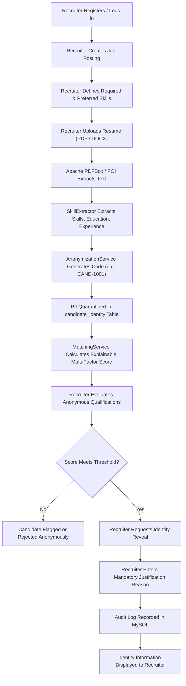
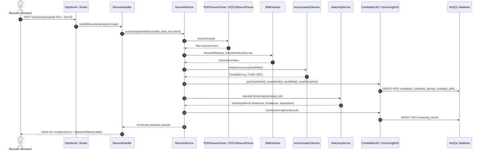
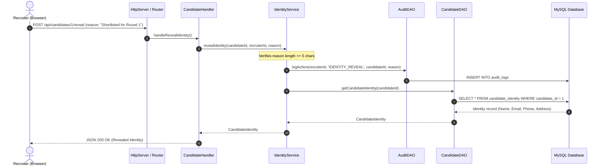

# BlindHire - System Workflows & Diagrams

This document details the end-to-end data flow, system architecture diagrams, and sequence diagrams for the BlindHire application.

---

## 1. High-Level Recruitment Workflow

---

## 2. Sequence Diagram: Resume Ingestion & Screening Engine

---

## 3. Sequence Diagram: Controlled Identity Reveal Flow

---

## 4. Multi-Factor Scoring Mathematical Model

BlindHire calculates the overall match score using a four-factor weighted formula:

$$\text{Final Score} = (\text{Skill Score} \times 0.50) + (\text{Experience Score} \times 0.25) + (\text{Education Score} \times 0.15) + (\text{Project Score} \times 0.10)$$

### 1. Skill Score (50% Overall Weight)
Compares candidate skills against job skill taxonomy:
$$\text{Skill Score} = \left(\frac{\text{Matched Required}}{\text{Total Required}} \times 80\right) + \left(\frac{\text{Matched Preferred}}{\text{Total Preferred}} \times 20\right)$$

### 2. Experience Score (25% Overall Weight)
Compares candidate verifiable experience years ($E_c$) with job minimum requirement ($E_{\min}$):
$$\text{Experience Score} = \begin{cases} 
100\% & \text{if } E_c \ge E_{\min} \text{ or } E_{\min} = 0 \\ 
\left(\frac{E_c}{E_{\min}}\right) \times 100\% & \text{if } E_c < E_{\min} 
\end{cases}$$

### 3. Education Score (15% Overall Weight)
Evaluates educational benchmarks based on degree hierarchy (M.Tech/PhD = 100%, B.Tech/MCA = 95%, BCA/B.Sc = 80%, Diploma = 70%), adjusted by academic grade percentages.

### 4. Project Score (10% Overall Weight)
Quantifies practical engineering demonstrations:
- 3+ Relevant Projects: 95%
- 2 Projects: 85%
- 1 Project: 70%
- 0 Projects: 50%
